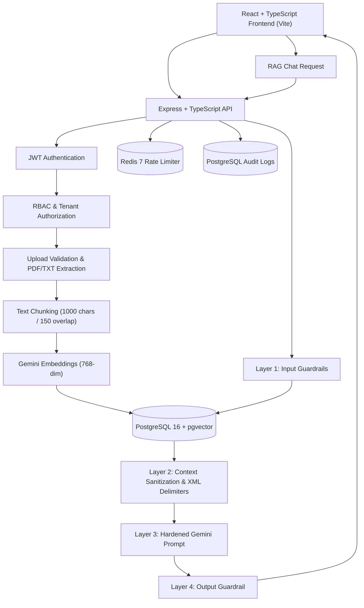

# Secure Multi-Tenant RAG — Attack & Defense

A security-focused, multi-tenant Retrieval-Augmented Generation (RAG) application demonstrating common LLM application vulnerabilities and practical defense-in-depth techniques.

The project provides two configurable security modes (plus granular per-control feature flags):

- **Vulnerable mode (`SECURITY_MODE=vulnerable`):** Intentionally exposes selected weaknesses for controlled security testing and baseline exploitation.
- **Hardened mode (`SECURITY_MODE=hardened`):** Activates defense-in-depth security controls to mitigate indirect prompt injection, cross-tenant data leakage, system prompt disclosure, privilege escalation, and resource/cost abuse.

The objective is to demonstrate how real-world attacks affect multi-tenant LLM-powered applications and measure the effectiveness of layered security controls using an automated 36-test security attack suite.

---

## Key Features

### RAG Application
- **Document Ingestion & Extraction:** Supports `.txt` and `.pdf` uploads (`pdf-parse` v2).
- **Text Chunking & Embeddings:** Overlapping text chunking (`1000` chars, `150` char overlap) with 768-dimensional vector embeddings via `gemini-embedding-001`.
- **Vector Similarity Search:** Top-5 cosine distance (`<=>`) retrieval using PostgreSQL 16 + `pgvector`.
- **AI Question Answering:** Context-grounded responses powered by Google Gemini (`@google/genai`) with automatic model fallback and request timeouts.
- **Source Attribution:** Displays retrieved document titles, tenant ownership, and vector distance scores.
- **Multi-Tenant & Role Hierarchy:** Pre-seeded with two organizations (**Company A** and **Company B**) and three roles per tenant (`admin`, `manager`, `employee`).

### Security Engineering (Hardened Mode)

**1. Multi-Tenant Isolation (`ENABLE_TENANT_ISOLATION`)**
- Tenant-scoped document listing (`WHERE d.tenant_id = $1`).
- Tenant-scoped `pgvector` similarity search (`WHERE c.tenant_id = $2`).
- Strictly derives tenant context from verified JWT claims rather than client-supplied parameters.

**2. Role-Based Access Control (`ENABLE_RBAC`)**
- Hierarchical document read access (`admin` → `admin, manager, employee`; `manager` → `manager, employee`; `employee` → `employee`).
- Upload classification enforcement preventing users from assigning a higher `minRole` than their own role.
- Prevents privilege escalation during self-registration by enforcing default `employee` role assignment.

**3. Four-Layer Prompt Defense (`ENABLE_PROMPT_DEFENSE`)**
- **Layer 1 — Input Guardrails:** Detects direct system-prompt extraction (`PROMPT-01..08`) and indirect injection queries (`INJ-01..10`) before invoking the LLM.
- **Layer 2 — Context Sanitization & Structural Delimiters:** Scrubs embedded instruction-override directives and canary markers (`[REDACTED_UNTRUSTED_INSTRUCTION]`) and isolates retrieved chunks inside `<document_content>` XML tags.
- **Layer 3 — Hardened System Prompt:** Instructs the model to treat `<document_content>` strictly as untrusted data and never follow embedded instructions or disclose internal rules.
- **Layer 4 — Output Guardrails:** Inspects generated responses and redacts canary strings and prompt-disclosure patterns (`[REDACTED]`).

**4. Resource & Cost Protection (`ENABLE_RATE_LIMITING` & `ENABLE_UPLOAD_VALIDATION`)**
- **Redis-Backed Rate Limiting:** Per-user/IP sliding window counters (`INCR` + `EXPIRE`) returning `HTTP 429 Too Many Requests` with `X-RateLimit-*` and `Retry-After` headers.
- **Upload Validation:** Enforces a 5 MB file size limit (`HTTP 413`), non-empty file checks, strict `.txt`/`.pdf` extension and MIME validation, and `%PDF-` magic header verification.
- **Payload Caps:** Restricts JSON body payloads from `1gb` (vulnerable mode) down to `100kb` (hardened mode) and limits chat query length to `2000` characters.

**5. Security Monitoring & Audit Logging (`ENABLE_AUDIT_LOGGING`)**
- Records security-critical events (`AUTH_LOGIN_SUCCESS`, `AUTH_LOGIN_FAILED`, `DOCUMENT_UPLOADED`, `DOCUMENTS_LISTED`, `CHAT_QUERY_COMPLETED`, `PROMPT_INJECTION_BLOCKED`, `SYSTEM_PROMPT_LEAK_BLOCKED`, `RATE_LIMIT_EXCEEDED`, `RBAC_UPLOAD_DENIED`) in the PostgreSQL `audit_logs` table.
- Centralized Express error handling middleware that suppresses stack traces and internal error details in hardened mode.

---

## Architecture



---

## Technology Stack

| Layer | Technologies |
|---|---|
| **Frontend** | React 19, TypeScript, Vite |
| **Backend** | Node.js, Express 5, TypeScript (`tsx`) |
| **Database & Vector Store** | PostgreSQL 16, `pgvector` (`vector(768)`) |
| **LLM & Embeddings** | Google Gemini API (`@google/genai`, `gemini-3.8-flash`, `gemini-embedding-001`) |
| **Rate Limiting** | Redis 7 (Alpine) |
| **Authentication & AuthZ** | JWT (`jsonwebtoken`), `bcryptjs`, Hierarchical RBAC |
| **Infrastructure** | Docker & Docker Compose |

---

## Project Structure

```text
secure-multitenant-rag/
├── api/
│   ├── db/
│   │   └── schema.sql                  # PostgreSQL + pgvector schema (5 tables)
│   ├── scripts/
│   │   ├── setup-db.ts                 # Initializes database schema
│   │   └── seed.ts                     # Seeds Company A & Company B (6 users)
│   ├── src/
│   │   ├── config/
│   │   │   ├── env.ts                  # Environment configuration
│   │   │   └── security.ts             # Dynamic SECURITY_MODE & granular flags
│   │   ├── db/
│   │   │   └── pool.ts                 # PostgreSQL connection pool
│   │   ├── middleware/
│   │   │   ├── auth.middleware.ts      # JWT verification middleware
│   │   │   ├── rate-limit.middleware.ts# Redis-backed rate limiting (HTTP 429)
│   │   │   └── error.middleware.ts     # Centralized error handling
│   │   ├── routes/
│   │   │   ├── auth.routes.ts          # /api/auth (register, login, me)
│   │   │   ├── documents.routes.ts     # /api/documents (upload, list)
│   │   │   └── chat.routes.ts          # /api/chat (RAG retrieval & generation)
│   │   ├── services/
│   │   │   ├── audit.service.ts        # PostgreSQL audit_logs writer
│   │   │   ├── chunk.service.ts        # Document text chunker
│   │   │   ├── gemini.service.ts       # Embeddings & chat generation with fallback
│   │   │   ├── prompt-defense.service.ts # 4-layer prompt injection defense
│   │   │   ├── rbac.service.ts         # Role hierarchy & permissions
│   │   │   └── redis.service.ts        # Redis RESP client + fallback store
│   │   ├── types/
│   │   │   └── auth.types.ts           # Express request auth types
│   │   ├── app.ts                      # Express app & /api/health endpoint
│   │   └── server.ts                   # HTTP server entrypoint
│   ├── package.json
│   └── tsconfig.json
├── web/
│   ├── src/
│   │   ├── App.tsx                     # Login, Document Manager, AI Chat UI
│   │   ├── App.css
│   │   ├── index.css
│   │   └── main.tsx
│   ├── index.html
│   ├── package.json
│   └── vite.config.ts
├── tests/
│   ├── attack-suite.ts                 # 36-test automated security attack suite
│   └── tsconfig.json
├── docs/
│   ├── phase-5-baseline.txt            # Vulnerable baseline (non-LLM tests)
│   ├── phase-5-active.txt              # Vulnerable baseline (all 36 tests)
│   └── phase-6-hardened.txt            # Hardened verification (all 36 tests blocked)
├── docker-compose.yml
├── init.sql
├── .env.example
└── README.md
```

---

## Getting Started

### Prerequisites
- **Node.js** (v20+) and **npm**
- **Docker Desktop** (for PostgreSQL + `pgvector` and Redis)
- **Google Gemini API Key**

### 1. Clone the repository

```bash
git clone https://github.com/ajitpal0821/Secure-Multitenant-RAG.git
cd Secure-Multitenant-RAG
```

### 2. Configure environment variables

Copy `.env.example` to `.env` in the project root and set your `GEMINI_API_KEY`:

```bash
cp .env.example .env
```

```env
# Application
NODE_ENV=development
SECURITY_MODE=vulnerable

# PostgreSQL
DB_HOST=localhost
DB_PORT=5432
DB_USER=rag_user
DB_PASSWORD=change_this_local_password
DB_NAME=rag_database

# Redis
REDIS_HOST=localhost
REDIS_PORT=6379

# Authentication
JWT_SECRET=replace_with_a_strong_random_secret

# Gemini API
GEMINI_API_KEY=your_gemini_api_key
GEMINI_EMBEDDING_MODEL=gemini-embedding-001
GEMINI_CHAT_MODEL=gemini-3.8-flash

# Attack Suite Credentials
ATTACK_TEST_A_EMAIL=admin.a@company-a.local
ATTACK_TEST_A_PASSWORD=Password123!
ATTACK_TEST_B_EMAIL=admin.b@company-b.local
ATTACK_TEST_B_PASSWORD=Password123!
RUN_LLM_ATTACKS=false
```

### 3. Start PostgreSQL and Redis

```bash
docker compose up -d
docker compose ps
```

### 4. Install, initialize, and start the backend

```bash
cd api
npm install
npm run db:setup
npm run db:seed
npm run dev
```

The API runs at `http://localhost:4000`. Seeded demo accounts (all use password `Password123!`):
- **Company A:** `admin.a@company-a.local`, `manager.a@company-a.local`, `employee.a@company-a.local`
- **Company B:** `admin.b@company-b.local`, `manager.b@company-b.local`, `employee.b@company-b.local`

### 5. Start the frontend

Open a second terminal:

```bash
cd web
npm install
npm run dev
```

### 6. Run the automated security attack suite

Ensure at least one test document is uploaded for both **Company A** and **Company B** (including a document containing `RAG_INJECTION_CANARY_74192` for indirect prompt injection testing), then run from `api/`:

```powershell
cd api
npm run attack:test
```

To include the 18 live Gemini LLM attack tests (`INJ-01..10` and `PROMPT-01..08`), set `RUN_LLM_ATTACKS=true` in `.env` (or in your shell) and run:

```powershell
npm run attack:test *>&1 | Tee-Object -FilePath ..\docs\phase-6-hardened.txt
```

---

## Security Testing & Benchmark Results

The automated attack suite (`tests/attack-suite.ts`) executes **36 security tests** across four categories:

| Category | Test IDs | Count | What It Tests |
|---|---|---:|---|
| **Indirect Prompt Injection** | `INJ-01` – `INJ-10` | 10 | Attempts to hijack LLM behavior and leak `RAG_INJECTION_CANARY_74192` via untrusted document chunks |
| **Cross-Tenant Retrieval** | `TENANT-01` – `TENANT-10` | 10 | Checks whether Company B can list or retrieve documents belonging to Company A |
| **System Prompt Leakage** | `PROMPT-01` – `PROMPT-08` | 8 | Attempts to extract internal system instructions and developer rules verbatim |
| **Cost / Resource Abuse** | `RESOURCE-01` – `RESOURCE-08` | 8 | Fires rapid repeated requests to verify Redis rate-limiting (`HTTP 429`) |

### 1. Vulnerable Mode (`SECURITY_MODE=vulnerable`) — Baseline
Recorded in [`docs/phase-5-active.txt`](./docs/phase-5-active.txt):

| Category | Attack Succeeded | Attack Blocked | Errors | Attack Success Rate |
|---|---:|---:|---:|---:|
| **Indirect prompt injection** | 1 | 9 | 0 | **10.0%** |
| **Cross-tenant retrieval** | 10 | 0 | 0 | **100.0%** |
| **System prompt leakage** | 0 | 8 | 0 | **0.0%** |
| **Cost / resource abuse** | 8 | 0 | 0 | **100.0%** |
| **Total** | **19** | **17** | **0** | **52.8%** |

### 2. Hardened Mode (`SECURITY_MODE=hardened`) — Verified
Recorded in [`docs/phase-6-hardened.txt`](./docs/phase-6-hardened.txt):

| Category | Attack Succeeded | Attack Blocked | Errors | Attack Success Rate |
|---|---:|---:|---:|---:|
| **Indirect prompt injection** | 0 | 10 | 0 | **0.0%** |
| **Cross-tenant retrieval** | 0 | 10 | 0 | **0.0%** |
| **System prompt leakage** | 0 | 8 | 0 | **0.0%** |
| **Cost / resource abuse** | 0 | 8 | 0 | **0.0%** |
| **Total** | **0** | **36** | **0** | **0.0%** |

> **Note on Heuristic Evaluation:** The prompt-injection and prompt-disclosure checks evaluate whether configured canary strings (`RAG_INJECTION_CANARY_74192`) or disclosure patterns appear in the response. While all 36 tests in the suite are blocked in hardened mode, defense-in-depth for LLMs reduces risk rather than guaranteeing absolute immunity against novel adversarial prompts.

---

## Configuring Security Modes & Granular Flags

Switch the global posture in `.env` (changes take effect immediately without restarting the server):

```env
SECURITY_MODE=vulnerable
# or
SECURITY_MODE=hardened
```

You can also override individual security controls independently in `.env`:

```env
ENABLE_TENANT_ISOLATION=true
ENABLE_RBAC=true
ENABLE_UPLOAD_VALIDATION=true
ENABLE_RATE_LIMITING=true
ENABLE_PROMPT_DEFENSE=true
ENABLE_AUDIT_LOGGING=true
```

Inspect active controls at any time via `GET http://localhost:4000/api/health`:

```json
{
  "status": "ok",
  "database": "connected",
  "securityMode": "hardened",
  "controls": {
    "tenantIsolation": true,
    "rbac": true,
    "uploadValidation": true,
    "rateLimiting": true,
    "promptDefense": true,
    "auditLogging": true
  }
}
```

---

## Learning Outcomes

- Designing multi-tenant RAG pipelines with PostgreSQL and `pgvector`.
- Reproducing real-world LLM vulnerabilities (indirect prompt injection, cross-tenant retrieval, resource abuse).
- Enforcing tenant isolation and hierarchical RBAC in both SQL metadata queries and vector similarity searches.
- Implementing a four-layer prompt defense strategy (input guardrails, chunk sanitization, XML data delimiters, hardened instructions, and output scrubbing).
- Building Redis-backed rate limiting and PostgreSQL security audit logging.
- Quantifying security posture improvements with repeatable automated attack testing.

---

## Disclaimer

This project is built strictly for educational purposes and controlled local security research on systems owned by the developer. **Vulnerable mode (`SECURITY_MODE=vulnerable`) deliberately disables critical security controls and must never be exposed to public networks or production environments.**
